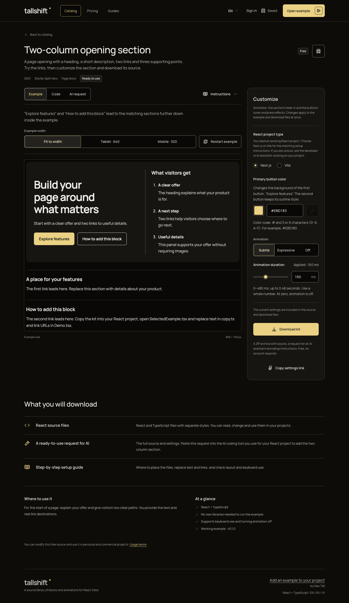
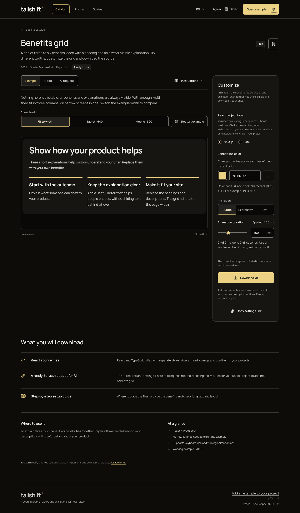
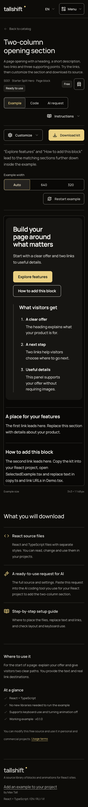

# S001/S002/A003/A006 · Закрытие этапа бесплатных примеров · 26.11.2026

> Полные доказательства прогонов (скриншоты и JSON) хранятся вне Git по [критериям, редакция 2](../knowledge-base/product-evaluation-criteria.ru.md): в репозитории оставлены ключевые снимки, остальное — локально в `prototype/.qa/evidence-archive/`.

Поручение Max Tall от 26.11.2026, направление 3 из трёх: закрыть незавершённую 07.11 проверку четырёх бесплатных примеров и упаковки CSS Modules. Роли: `frontend-engineer` (основной агент), `product-designer` и `qa-engineer` (тот же агент, по своим чек-листам), `ux-copywriter` — отдельный агент. Ветка `claude/free-examples-final-1ac280` от `c1249f5`; код `prototype/` совпадает с развёрнутым 10.11 коммитом `65a273f`. Работа локальная: ничего не развёртывалось, push не делался.

Статусы: **реализовано и проверено локально**; **пользователем не утверждено**; на tallshift.com и preview.tallshift.com изменения этой ветки ещё не опубликованы. Правила, которые остаются для следующих примеров, — [KB-UI-013](../knowledge-base/free-examples-final-2026-11-26.ru.md).

## Сводка по шаблону критериев v2

- **Полоса и задача:** B (готовые позиции каталога), направление 3 от 26.11.2026 — закрыть проверку S001/S002/A003/A006 и упаковки CSS Modules.
- **Что сделано:** исправлены дефекты демо и комплектов (раздел 1), тексты прошли копирайтера, добавлены проектные проверки: браузер четырёх примеров, подписи и заголовки всех девяти, разбор Hallmark для CSS Modules, сверка живых ZIP.
- **Скриншоты 1440 и 375:** ниже, три ключевых снимка. Остальные 46 снимков и все JSON и логи прогонов лежат локально в `prototype/.qa/free-examples-final-2026-11-26/`: по критериям v2 доказательства хранятся вне Git.
- **Проверено:** раздел 2. Браузер — 164 проверки геометрии и 12 сверок ZIP. Регрессия: 157, 159 и 343 случая. Подписи — 1626 измерений, нарушение одно — известное у A001. Unit 277/277, сборка, `test:study`, `test:examples` 96 + 16. Hallmark, сырой итог: рецепты 57 FAIL / 0 REFLEX / 0 WARN; продукт и платформа 0/0/0.
- **Не проверено и почему:** раздел 5. Гидратация в Next — проверим при интеграции после обновления до 16.4.5. Демо-сервер и живые ZIP — нужно развёртывание. Screen reader, носитель VI, ЦА, `user-critic` — не проводились.
- **Нужно от Max Tall:** решение по крупным заголовкам демо принято 27.11 — вариант (а), раздел 2а. Новых вопросов нет. Перед выпуском нужно слить исправление A001 и повторить проверку подписей.

| S001, 1440 px: две колонки | S002, 1440 px: три колонки без «сироты» | S001, 375 px |
| --- | --- | --- |
|  |  |  |

## 1. Четыре примера: найденные дефекты и исправления

| Пример | Что было не так (как увидит первый клиент) | Исправление |
| --- | --- | --- |
| S001 «Первый экран в две колонки» | Две колонки включались при ширине секции от 960 px. Превью «По ширине» на 1440 px — около 880–896 px, поэтому ни на 320, ни на 768, ни на 1440 пример не показывал две колонки. | Порог 720 px: на 1440 две колонки, на «Планшет 640» и 320 — одна. |
| S001 | Ссылки «Посмотреть возможности» / «Как подключить блок»: на локальном стенде клик загружал внутрь превью страницу сайта (в srcdoc есть `<base href>`), пример исчезал. На демо-сервере клик менял hash внутри iframe и визуально ничего не делал — страница не прокручивалась, фокус не переходил (проверено на tallshift.com, только чтение). | `Demo.tsx` сам обрабатывает клик, как в E001/C001: `preventDefault`, фокус на раздел (`tabIndex={-1}`), `scrollIntoView`. Кольцо фокуса — только после клавиатуры. Инструкция объясняет, что на своей странице обработчик не нужен. На демо-сервере после развёртывания не проверено. |
| S002 «Сетка преимуществ» | На 1440 px три карточки стояли 2 + 1: третья под первой, справа пусто. Контейнер 832 px не доходил до порога трёх колонок 860 px. | Колонки по числу карточек (`data-count`): 3 — одна, затем сразу три (от 640 px); 4 — 2 × 2; 5–6 — две, затем три. Инструкция обновлена. |
| S002 | Неиспользуемый `Demo.module.css` (его не импортировал ни один файл и он не входил в ZIP) давал 3 FAIL Hallmark. | Файл удалён. |
| A003, A006 | Кнопки демо: отступы `10px 14px` вне шкалы 4 px (REFLEX 24b), нет стиля недоступной кнопки (REFLEX 26b), заголовок без `text-wrap: balance` (WARN F3). | `12px 16px`, стиль `:disabled` с токеном `--f-muted` и `GrayText` в forced colors, `text-wrap: balance`. |
| Все рецепты | Скачанный комплект выглядел не как демо. В Tallshift цвета приходят из `--f-*` хоста, а у пользователя работают значения по умолчанию. Поверхность S001/S002/S003 — `#1E1D19` вместо `#161512`; кольцо фокуса E001/A003/A006/C001/C002 — `#F7EBCB` или акцент вместо `#B8B8B2`; текст кнопки C001 — `#17150F`, которого нет в утверждённой палитре, вместо `#171C1A`. Измерено в браузере: демо показывает `rgb(22, 21, 18)` и `#B8B8B2`. | Значения по умолчанию приведены к утверждённым ролям `getSaffronTheme('light')`. В продукте вид не меняется: хост по-прежнему передаёт `--f-*`. |
| Все четыре | Имя в первой строке запроса для ИИ не совпадало с заголовком страницы в 8 из 12 сочетаний пример × язык (например, «Feature grid» при H1 «Benefits grid»). | `displayName` = название страницы; тест `example-public-names` для всех 8 сгенерированных примеров и 3 языков. |
| Общие строки страницы примера | Помощь вкладки «Запрос для ИИ» и заголовок условий говорили «код кнопки» у всех примеров. Сообщение о скопированной ссылке обещало цвет и у примеров без цвета. В английском британское «Colour», а весь сайт пишет «color». | Общие формулировки в `product-copy.ts`: «код примера», «условия использования бесплатного кода», «ссылка откроет пример с текущими настройками»; US «color». |
| Каталог, S001 | Описание обещало «одно основное действие», а в примере две ссылки и три пояснения. | Описание называет фактический состав. |

Редакторская проверка — в [журнале копирайтера](../knowledge-base/copy-review.ru.md), раздел 26.11.2026: понятные публичные названия, объяснения демо (A003 объясняет, почему при открытии нет движения), «комплект» вместо «bundle», честные формулировки о совместимости с Next.js, справка без внутренних отсылок. Из шести предложений копирайтера вне его зоны применены пять. Шестое — остаток 2 + 2 + 1 у пяти карточек S002 на средней ширине — оставлено и описано в инструкции.

## 2. Проверки, которые выполнены

Все команды — из `prototype`, локально, 26–27.11.2026. Файлы доказательств, упомянутые ниже, лежат в `prototype/.qa/free-examples-final-2026-11-26/` — локально, вне Git. Скрипты по умолчанию тоже пишут в `prototype/.qa/`.

- **Браузер, 4 примера.** `scripts/verify-free-examples.mjs`, стенд Vite `http://127.0.0.1:4173`, временный профиль Chrome 158, разрешён только адрес стенда, загрузки запрещены. **164 проверки геометрии** (без горизонтального переполнения страницы и примера, без обрезанного текста в контролах). Охват: 4 примера × RU/EN/VI × 320/768/1440, после взаимодействий, мобильные настройки, код, запрос, инструкция, настройки. **0 ошибок страницы, 0 внешних запросов.** Сценарии:
  - S001: обе ссылки ведут к своим разделам, превью не перезагружается, фокус на разделе, раздел в зоне видимости, после клика мышью кольца нет;
  - S002: колонки 1 или 3 по реальной ширине, никогда не 2 + 1; в статичном списке нет фокусируемых элементов;
  - A003: «Повторить» вызывает настоящий `animate()` по словам, «Сменить заголовок» меняет текст, слова в покое видимы;
  - A006: добавление, обратный порядок с анимацией перемещения, фильтр, завершение, возврат в работу, удаление, оба пустых состояния, счётчик;
  - мобильный лист настроек: поле цвета только у S001/S002, предел 480 мс, Escape возвращает фокус.
- **Одни настройки — один результат**, 12 случаев (4 × RU/EN/VI). Выбраны Vite, цвет `#C4DB9B` (если есть), «Заметная», 210 мс. Демо применяет их: фон кнопки и цвет линии `rgb(196, 219, 155)`, длительность реального `animate()` 210 мс. ZIP со страницы побайтно равен архиву того же рецепта, собранному в Node (SHA-256). `config.json`, `manifest.json` и все контрольные суммы сходятся. Скопированный код равен `SelectedExample.tsx` из ZIP, скопированный запрос — `INTEGRATION_PROMPT.txt`. Инструкция показывает `INSTALL.{язык}.md`. Ссылка с настройками восстанавливает цвет и длительность.
- **Клавиатура, reduced motion, forced colors** (на каждый пример):
  - клик мышью не оставляет кольца, Tab даёт одно сплошное кольцо не тоньше 2 px; в S001 Enter по ссылке переносит кольцо на раздел;
  - при `prefers-reduced-motion: reduce` переключатель анимации недоступен с пояснением, `animate()` не вызывается, всё содержимое с непрозрачностью 1;
  - при `forced-colors: active` кольцо сплошное, текст отличим от фона.
- **Регрессия других примеров, где менялся CSS**:
  - `verify-starter-examples.mjs` (C001/C002) — 157 случаев;
  - `verify-reveal-action.mjs` (E001/S003) — 159 случаев;
  - общая проверка страниц `verify-product-copy.mjs` — 343 случая.

  Везде 0 ошибок и 0 внешних запросов. Скриптам добавлен `TALLSHIFT_QA_OUT`, чтобы не перезаписывать доказательства 06–07.11.
- **Комплекты.** `npm run test:examples`: 96 случаев (8 рецептов × 3 языка × Next/Vite × два режима запроса), 16 независимых React-сборок (TypeScript + Vite).
- **Next.js.** `npm run test:examples:next`: чистый Next 16.4.2 из 9 ZIP — компиляция, TypeScript и пререндер всех 9 маршрутов прошли. Затем CLI завершил команду с `SecurityFatalError`: сообщение об известной уязвимости этой версии Next.js, код 1. Повтор дал тот же результат. Поэтому `next start` и проверка гидратации в Next в этот раз **не выполнены**; лог — `next-consumer-build.txt`. В этой ветке версия не обновлялась. Обновление до 16.4.5 идёт в другой ветке; гидратацию в настоящем Next проверим при интеграции после него — по решению основной сессии.
- **Тесты и сборка.** `node --test --test-concurrency=2 tests/*.test.ts` — **277/277** (было 270; +5 тестов разбора Hallmark, +2 теста публичных имён; в тест секций добавлены проверки `data-count` и фокусируемых разделов). `npm run build` — прошла (прежнее предупреждение о размере чанка). `npm run test:study` — 12 случаев A001 прошли. `git diff --check` — чисто.
- **Иконки.** В изменённых файлах нет самодельных SVG/path, CSS-глифов и маркеров `
`.

## 2а. Подписи кнопок и заголовки всех девяти примеров

Правило критериев v2, полоса B: подписи кнопок и заголовки не рвутся по слогам и не занимают больше двух строк на ширинах 320–1440. Проверку добавил скрипт `scripts/verify-example-labels.mjs`. Измерение взято из проверки A001 сессии BETA-19: каждое слово — DOM Range, его прямоугольники должны лежать в одной строке. Строки — различные ряды всех слов.

Охват:
- все 9 готовых примеров × RU/EN/VI;
- страницы 320, 375, 768, 1024 и 1440 px, плюс переключатели ширины превью 640 и 320 px на 1440;
- элементы внутри демо: кнопки, вкладки, ссылки-кнопки и заголовки h1–h6;
- переключатели (`aria-pressed`, `aria-expanded`) и радиокнопки внутри демо нажимаются по очереди, чтобы проверить и сменные подписи.

Стенд локальный, временный Chrome, внешних запросов и ошибок страницы нет. Результат в `example-labels.json`.

**Решение Max Tall от 27.11.2026 — вариант (а).** Ограничение «две строки» действует для подписей кнопок и заголовков интерфейса. У крупных заголовков в демо (вычисленный размер шрифта от 24 px: первый экран, сетка, завершающий блок) проверяется только разрыв по слогам. Число их строк по-прежнему измеряется и выводится отдельно.

Итог после решения (27.11): **1626 измерений, 2 нарушения (только A001), разрывов слов по слогам — 0; крупных заголовков длиннее двух строк — 23, по решению это допустимо.** После исправлений по замечаниям критика (раздел 7) повторный прогон: те же 2 нарушения у A001, крупных заголовков длиннее двух строк — 26, демо A003/A006 получили внутренний отступ. До решения та же проверка в буквальном виде давала 25 нарушений: 2 у A001 и 23 у крупных заголовков.

- **A001 — известный результат до слияния.** Главная кнопка «Скопировать текст» в RU на ширине примера 288 px (страница 320) занимает 3 строки: 2 измерения, исходное состояние и режим ошибки. Исправление — коммит `c0e8069` в ветке `claude/heuristic-curie-0ce669`. В этой ветке A001 не правился. После слияния проверку нужно повторить; на ветке с исправлением она не запускалась.
- **Крупные заголовки демо длиннее двух строк — 23 измерения, допустимо по решению (а).**
  - S001 «Build your page around what matters» и переводы: 3–4 строки на ширине примера 288–343 px; в EN 3 строки и на 1440 px — с тех пор, как панель переехала во вторую колонку (раньше 1 строка, но без второй колонки).
  - S002: RU и VI — 3 строки на 288–343 px.
  - S003: RU — 3 строки на 288 px.
  - A003: RU — 3 строки на 288 px; EN — 3 строки на всех ширинах. Это намеренно: заголовок ограничен 18ch, чтобы показать построчное появление.

  Подписи кнопок в этих примерах — не длиннее двух строк.

Были предложены два варианта: (а) — ограничение строк только для подписей и заголовков интерфейса; (б) — подогнать крупные заголовки под две строки (меньший шрифт на узких экранах, короче тексты, другой пример A003). Max Tall выбрал (а). Скрипт изменён только в этой части, с явной пометкой решения в коде. Разрывы по слогам по-прежнему проверяются везде; находки не скрываются, крупные заголовки выводятся отдельным числом.

## 3. Hallmark: разбор 56 FAIL / 4 REFLEX / 2 WARN

Закреплённый Hallmark 2.0.0 запускался только через защищённую `npm run check:design` (сверка SHA-256, без сети, без унаследованных секретов). `.hallmark/security.json` и обёртка не менялись.

**Исходное состояние** (CSS с 07.11, повторено 26.11): 56 FAIL, 4 REFLEX, 2 WARN, 30 файлов. Все 56 FAIL — правило 48 «литерал цвета вне токенов». Каждый стоит на объявлении значения по умолчанию в блоке `:root .<корень> { --x-default-y: #… }`. CSS Modules запрещают голый `:root` (Next отвергает его как impure). Hallmark признаёт токенами только `:root`, `[data-theme]` и файл `tokens.css`, поэтому ни один селектор CSS Modules под это не подходит. Floor-правило 48 не снимается waiver.

**Разбор по каждому объявлению** — `npm run check:design:recipes` (`scripts/hallmark-recipes.mjs`, логика в `scripts/hallmark-token-blocks.mjs`):
- запускает неизменённую защищённую обёртку и печатает её сырой отчёт;
- сверяет число разобранных находок со сводкой checker и при расхождении останавливается;
- признаёт объявлением токена только такую находку:
  - `.module.css` в `src/recipes`;
  - строка внутри верхнеуровневого блока `:root .<класс>`;
  - в блоке только custom properties;
  - значение в точности равно указанному литералу;
  - у класса есть собственное правило, которое использует токен через `var()`;
  - значение равно утверждённому значению роли `--f-*`, которую оно заменяет, или (без роли) входит в утверждённую палитру.
- Всё остальное, включая REFLEX и WARN, остаётся открытым, и команда завершается с ошибкой.

**Отрицательный контроль** на исходном CSS: разбор подтвердил 46 объявлений. Открытыми остались **10 настоящих FAIL** и 4 REFLEX + 2 WARN:
- 6 значений фокуса: демо E001, A003, A006 и C001, сама кнопка C001, вкладки C002 (фокус брался из акцента);
- 3 поверхности секций: S001, S002, S003;
- 1 цвет текста кнопки C001 (`#17150F` вне палитры).

Три из 46 подтверждённых объявлений лежали в неиспользуемом файле S002 — он удалён. Вывод сохранён в `check-design-recipes-original-css.txt`.

**После исправлений**:
- закреплённый checker, сыро: **57 FAIL / 0 REFLEX / 0 WARN**, 29 файлов. Добавились токены `muted` в A003/A006, фокус C002 и фокус разделов S001; ушёл удалённый файл;
- проектный разбор: все **57 — проверенные объявления токенов**; открытых FAIL, REFLEX и WARN — **0** (`check-design-recipes.json`);
- продукт `src/product`: **0 / 0 / 0**, 23 файла; платформа `src/platform`: **0 / 0 / 0**, 3 файла.

Итог: 10 настоящих FAIL, 4 REFLEX и 2 WARN исправлены. 46 ложных срабатываний прежнего списка (43 в живых файлах и 3 в удалённом) — объявления токенов, которые закреплённый checker в CSS Modules распознать не может. Сырой счёт checker **не равен нулю и не объявлен нулём**. Почему не перенос в глобальный `tokens.css`: это добавило бы глобальные `:root`-переменные и импорт глобального CSS в каждый компонент пользователя, связало бы рецепты с общими именами — только ради линтера. Тест `hallmark-token-blocks` дополнительно проверяет все поставляемые объявления, без запуска Hallmark.

По критериям v2 («Проверки проверок») классификатор `check:design:recipes` дальше меняется только с отдельного «да» Max Tall. В каждом отчёте указывается сырой счёт checker.

## 4. Выдача бесплатных комплектов

- **Неизменяемого публикатора и реестра Free нет.** ZIP собирается в браузере пользователя из исходников, встроенных в JS развёрнутой версии (`createExampleRecipe().archive`). Manifest: `releaseStatus: local-prototype`, `itemVersion: 0.1.0-prototype`. Эндпоинта `/assets/free/{id}/{version}/{bundleDigest}.zip`, release manifest с commit/hash и статусов published/revoked из ТЗ v0.2 нет. Серверный `publishedPaidReleases` пуст (зона платформы).
- **Производственные «ворота» выдачи** сейчас такие: пример есть в `availableExampleIds` и подключён рецептом; страница блокирует скачивание при неприменённом цвете или неверной длительности. Проверки релиза — версии, review, сверки с реестром перед выдачей — нет.
- **Совпадение живого ZIP с ожидаемым SHA-256.** `scripts/verify-free-delivery.mjs` (только чтение): ожидаемые архивы из исходников — затем настоящая кнопка «Скачать комплект» на сайте во временном Chrome. Разрешён только адрес сайта, загрузки запрещены, байты читаются из Blob, на диск ничего не сохраняется. До изменений этой ветки, на коде, равном развёрнутому:
  - **tallshift.com — 36/36 совпадений**;
  - **preview.tallshift.com — 36/36 совпадений**.

  Охват: 9 примеров × RU/EN/VI с Next + EN с Vite, настройки страницы по умолчанию. Ошибок страниц нет. Файлы: `free-delivery-tallshift.com.json`, `free-delivery-preview.tallshift.com.json`.
- **После развёртывания этой ветки** изменятся 32 из 36 проверяемых ZIP (все, кроме A001): правки CSS и текстов. Новые ожидаемые хеши — `free-delivery-expected.json`. Сверку нужно повторить командой `HALLMARK_PUPPETEER=… node scripts/verify-free-delivery.mjs https://tallshift.com`.

## 5. Не проверено и ограничения

- Изменения не развёрнуты. Поведение ссылок S001 на демо-сервере после исправления, гидратация в настоящем Next.js runtime и живые ZIP новой версии не проверены.
- Проверялись настройки по умолчанию и один нестандартный набор (Vite, `#C4DB9B`, «Заметная», 210 мс). Другие сочетания покрыты unit- и export-тестами, но не браузером.
- Screen reader, сенсорные устройства, носитель вьетнамского, исследование с ЦА и независимый `user-critic` не проводились.
- Браузерные скрипты зависят от временного `puppeteer-core@24.43.1`. Его установили без сети из локального кэша npm (`npm install --offline --ignore-scripts`) во временную папку сессии. Прежняя `/tmp/tallshift-hallmark-runtime` пуста.

## 6. Наблюдения вне зоны этого направления

- Продакшен-HTML для браузерных запросов содержит маяк Cloudflare Web Analytics (`static.cloudflareinsights.com/beacon.min.js`) при CSP `connect-src 'self'`. Стоит проверить, включён ли он намеренно и как это сочетается с текстами о приватности.
- CLI Next.js 16.4.2 при сборке сообщает об известной уязвимости. Обновление до 16.4.5 подготовлено в другой ветке; при интеграции с этой веткой нужно повторить `test:examples:next` с гидратацией.
- Поле длительности применяет каждое допустимое нажатие (2 → 21 → 210 мс), поэтому S001/S002 при наборе несколько раз заново проигрывают появление. Это общий контрол, а не дефект примеров.
- Кнопка шапки «Открыть пример» на странице любого примера ведёт на A001; термины словаря справки не локализованы (замечания копирайтера, низкий приоритет).

## 7. Исправления по замечаниям независимого критика · 27.11.2026

Отдельная сессия `user-critic` посмотрела четыре примера и справку на локальном стенде. Блокеров не нашла. Отчёт лежит локально: `prototype/.qa/user-critic-free-examples-2026-11-27.md`. По решению Max Tall исправлены быстрые пункты:

- **Запрос для ИИ.** Первая строка больше не ломает падеж: «Подключи пример «Сетка преимуществ» (Starter Feature Grid, S002)…». В EN — «the example “…”», в VI — «ví dụ “…”». Закреплено тестом `example-public-names`.
- **A006, кнопка фильтра.** Подпись всегда «Только активные», включённый фильтр показывает состояние «нажата». Раньше включённая кнопка называлась «Все задачи», хотя показаны были только активные.
- **A003 и A006.** Внутренний отступ примера (24 px, на узком экране 16 px), как у S001/S002. Отступ сузил кнопки строк A006. Проверка подписей сразу поймала разрыв «Завершить» по слогам на 320 px (RU). Причина — `overflow-wrap: anywhere` у кнопок демо; замена на `break-word` переносит кнопку целиком.
- **Повторы.** Пояснение над A003 больше не повторяет текст внутри примера и объясняет разницу кнопок: эффект запускает кнопка в примере, кнопка над примером перезагружает его целиком. Название кнопки не указано, потому что на сайте и на стенде оно разное. У A006 убрана повторная фраза о сервере, она есть под списком.
- **Скачиваемый код.** Служебные комментарии проверки дизайна (штамп Hallmark и строка Critique) вырезаются из CSS при выдаче — функция `distributedSource`. Остальной код совпадает с подключённым побайтно; это проверяет `test:examples`. В исходниках проекта комментарии остались, их требует Hallmark.

Проверено после исправлений:
- unit 277/277, сборка, `test:study`, `test:examples` 96 случаев и 16 сборок;
- браузер четырёх примеров: 164 проверки и 12 сверок ZIP, ошибок нет;
- подписи всех девяти: 1626 измерений, нарушения только у A001;
- Hallmark сырой: рецепты 57 FAIL / 0 REFLEX / 0 WARN, открытых 0; продукт 0/0/0.

Второй круг по просьбе Max Tall («делай это»):
- **Куда вставить код.** Инструкция каждого из восьми генерируемых примеров начинается с «Быстрого старта» для выбранного типа проекта. Там указана папка `src/recipes/<slug>/` и готовый файл: `app/page.tsx` для Next.js (импорт через `@/`, с подсказкой про относительный путь) или `src/App.tsx` для Vite. Тот же текст стоит в конце запроса для ИИ. Закреплено тестом `example-public-names`.
- **Шапка.** На странице примера кнопка «Открыть пример» больше не показывается: она вела в другой пример (A001).
- Проверено: unit 277 + 1 новый тест, сборка, `test:examples`; браузер — все страницы продукта (343 случая) и четыре примера (164 и 12 сверок ZIP).
- **Не подтвердилось:** у поля цвета есть подпись, связанная через `label for`. Доступное имя — название поля, а не значение; критик видел дерево доступности скрытой панели.

Не сделано, отдельные задачи:
- чистый блок вместо демо в `SelectedExample.tsx`: переделка всех примеров;
- кнопка «Открыть бесплатный пример» в справке всё ещё ведёт в A001;
- коды S001/E001 на виду у клиента;
- корневая папка в ZIP;
- сила эффекта A003 по умолчанию;
- выбор количества карточек S002;
- доступное имя поля цвета.
